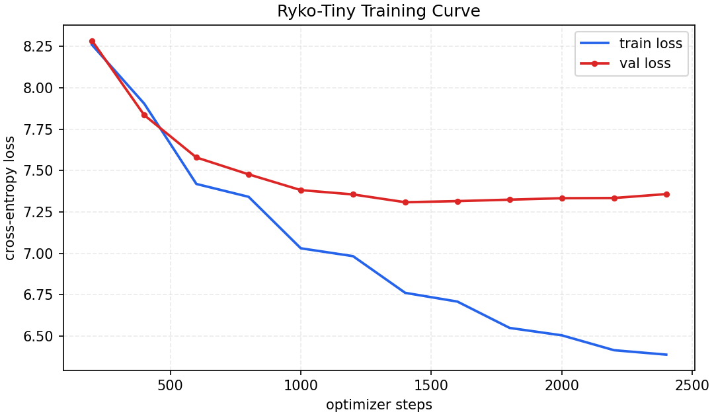

# Training Ryko — reference run and reproduction guide

## Reference run: Ryko-Tiny on CPU

Everything below was produced inside this repository with the committed
pipeline, on 2 CPU cores, across resumable chunks (`--time-budget`):

| item | value |
|---|---|
| config | `configs/models/ryko-tiny.yaml` |
| optimizer | AdamW (β 0.9/0.95), wd 0.1, clip 1.0 |
| schedule | warmup 100 → cosine 3.0e-4 → 3.0e-5 over 2,400 steps |
| batch | 8 sequences × 256 tokens = 2,048 tokens/step |
| total tokens seen | **4,915,200** (~0.9 epoch of the 5.38M-token train split) |
| wall time | ~42 minutes on 2 CPU cores (~2,000 tokens/s) |
| final | train 6.39 · val 7.28 · **PPL 1,445** |

### Loss curve



| step | train | val | lr |
|---:|---:|---:|---:|
| 200 | 8.259 | 8.284 | 2.99e-4 |
| 400 | 7.904 | 7.835 | 2.89e-4 |
| 600 | 7.419 | 7.579 | 2.70e-4 |
| 800 | 7.342 | 7.477 | 2.43e-4 |
| 1000 | 7.031 | 7.382 | 2.10e-4 |
| 1200 | 6.983 | 7.356 | 1.74e-4 |
| 1400 | 6.762 | 7.309 | 1.38e-4 |
| 1600 | 6.709 | 7.316 | 1.03e-4 |
| 1800 | 6.550 | 7.324 | 7.30e-5 |
| 2000 | 6.505 | 7.333 | 4.97e-5 |
| 2200 | 6.416 | 7.334 | 3.51e-5 |
| 2400 | 6.389 | 7.358 | 3.00e-5 |

### Interpretation (read this)

* The curve is healthy: fast initial descent, smooth cosine tail, val tracks
  train within ~1 nat — **no pathological overfitting** at 0.9 epoch.
* PPL ≈ 1,445 is **high, and honest**: an 11.5M model seeing 4.9M tokens is
  far below compute-optimal (Chinchilla suggests ≈ 230M tokens for this size).
* What it does produce: correctly-spelled Arabic, plausible morphology and
  function-word structure, register mixing (encyclopedic + classical).  What
  it cannot: factual or semantically coherent long passages.
* The pipeline is the product; scale is a config change.

### Samples (temperature 0.8, repetition penalty 1.15)

Full JSON: [results/samples.json](results/samples.json).

```
prompt: اللغة العربية
ryko:   ، هي مدينة في 15 يوليو 2010. ومن خلال العام عام 2007، كانت هي شركة ...

prompt: كان يا ما كان
ryko:   هو هو الأول أن يقال له ذلك وإن كان لهم أنه لا يجوز في رواية ابن عمر ...

prompt: العلم والتعليم
ryko:   هي «فيان». في عام 172، تم تأسيس الدولة العثمانية في الحرب العالمية ...
```

## Reproduce

```bash
# full reference pipeline (≈ 1 h CPU total; the tokenizer step takes 10 s)
make collect && make clean-corpus && make tokenizer && make binarize
make train                 # resumable: rerun until it prints [done]

# evaluate + publish results
make eval && make samples && make plot
```

Resumable chunks (how the reference run was produced):

```bash
python -m ryko_lm.training.train --config configs/models/ryko-tiny.yaml \
    --time-budget 500        # exits gracefully, rerun to continue
```

## Scaling to GPU configs

| preset | command | notes |
|---|---|---|
| `ryko-small` | `python -m ryko_lm.training.train --config configs/models/ryko-small.yaml` | 1 consumer GPU (24 GB), ~50k steps, bf16 autocast recommended |
| `ryko-base` | `torchrun --nproc_per_node=8 -m ryko_lm.training.train --config configs/models/ryko-base.yaml` | DDP across 8 GPUs; wrap the optimizer with ZeRO/FSDP for comfort |

Data scaling guidance: for a 52M model target ≈ 1B tokens (≈ 200× this corpus
— use the Wikimedia Arabic dump instead of the API sampler, and add
dialect/social corpora: LABR, MSAC, OSIAN).  The cleaning and tokenizer stages
are unchanged; raise `vocab_size` only if you add heavy dialect coverage.

## Artifacts inventory

| path | committed | content |
|---|---|---|
| `artifacts/tokenizer/ryko-tokenizer.json` | yes | trained BPE tokenizer (32,768) |
| `artifacts/tokenizer/tokenizer_meta.json` | yes | training metadata |
| `artifacts/training/final.pt` | yes | final fp16 checkpoint (config + weights) |
| `artifacts/training/log.jsonl` | yes | eval metrics every 200 steps |
| `artifacts/training/summary.json` | yes | final summary (steps, PPL, params) |
| `artifacts/training/{last,best}.pt` | no | resumable/val-best checkpoints |
| `docs/results/` | yes | loss curve, samples, tokenizer stats |
